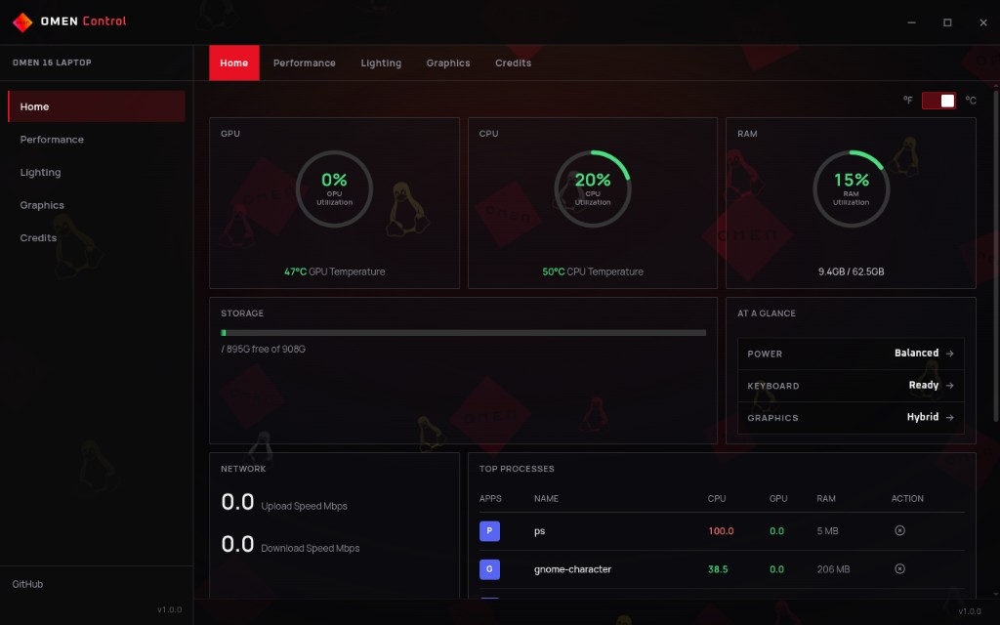

# OMEN Gaming Hub

Desktop UI for HP OMEN laptops on Linux — keyboard RGB, fans / thermal modes, graphics switching, and system vitals. Built as the companion app for the [omen-rgb-keyboard](https://github.com/OmenLinux/omen-rgb-keyboard) driver.

> [!WARNING]
> ## Support Scope
>
> This project is provided **as-is** and is maintained as community software for HP OMEN hardware on Linux. It is **not an official HP product**, and maintainers cannot support every laptop model, BIOS, kernel, distribution, or desktop environment.
>
> RGB and fan control require the [omen-rgb-keyboard](https://github.com/OmenLinux/omen-rgb-keyboard) kernel driver. Graphics switching depends on [optimus-manager](https://github.com/Askannz/optimus-manager) and a working NVIDIA / hybrid setup on your distro.
>
> If something fails because of HP firmware, missing WMI, an unsupported machine, or a broken Optimus / display-manager setup, it may **not** be fixable in this app. See the driver README for hardware support and troubleshooting, and report firmware issues to HP when appropriate.
>
> **OMEN** is a trademark of HP. This project is not affiliated with or endorsed by HP.

> [!TIP]
> Need help or want to chat? Join our **official Discord server**:
> **[➡️ Click here to join Discord](https://discord.gg/8UwyAJ7sBH)**

## Screenshots

<p align="center">
  
</p>

<p align="center"><em>Home — vitals, storage, network, and top processes</em></p>

## Features

- **Lighting** — 4-zone RGB, brightness, and driver animation modes with a live keyboard preview
- **Performance** — thermal / power profiles and fan control when the driver sysfs interface is present
- **Graphics** — optimus-manager mode switching plus setup / repair helpers (Fedora-friendly)
- **Home** — temps, utilization, storage, network, and top processes
- **Updates** — in-app auto-update from GitHub Releases (AppImage on Linux, NSIS on Windows)

## Requirements

| Piece | Notes |
|-------|--------|
| Linux (primary) | AppImage recommended; `.deb` also published |
| [omen-rgb-keyboard](https://github.com/OmenLinux/omen-rgb-keyboard) | Needed for keyboard RGB and fan / thermal sysfs |
| [optimus-manager](https://github.com/Askannz/optimus-manager) | Optional; only for hybrid graphics switching |
| Node.js 20+ | Only if building from source |

## Installation

### Prebuilt packages

Download the latest build from **[Releases](https://github.com/OmenLinux/omen-rgb-keyboard-ui/releases/latest)**.

**Linux (AppImage — recommended for in-app updates)**

```bash
chmod +x OMEN\ Gaming\ Hub-*.AppImage
./OMEN\ Gaming\ Hub-*.AppImage
```

A `.deb` is also published. Prefer the **AppImage** if you want automatic updates from inside the app.

**Windows**

Run the NSIS installer from the same Releases page.

### Kernel driver

RGB and fan features need the driver. Follow the install docs there:

```bash
git clone https://github.com/OmenLinux/omen-rgb-keyboard.git
cd omen-rgb-keyboard
sudo make install
# optional: non-root sysfs access
sudo ./install-udev-rules.sh
```

The Hub can also walk through driver install from the welcome / driver UI when sysfs is missing.

## Develop

```bash
npm ci
npm run dev
```

```bash
npm run build:renderer   # Vite → dist/renderer
npm run build:linux      # AppImage + deb (local, no publish)
npm run build:win        # NSIS (local, no publish)
```

## Related

- [omen-rgb-keyboard](https://github.com/OmenLinux/omen-rgb-keyboard) — kernel RGB + fan sysfs
- [omen-web](https://github.com/OmenLinux/omen-web) — docs & community site
- [OmenLinux](https://github.com/OmenLinux) — org

## Contributing

Feel free to submit issues and pull requests.

## Disclaimer

This software is provided as-is, use at your own risk. The authors are not responsible for any damage to your hardware or system configuration.
